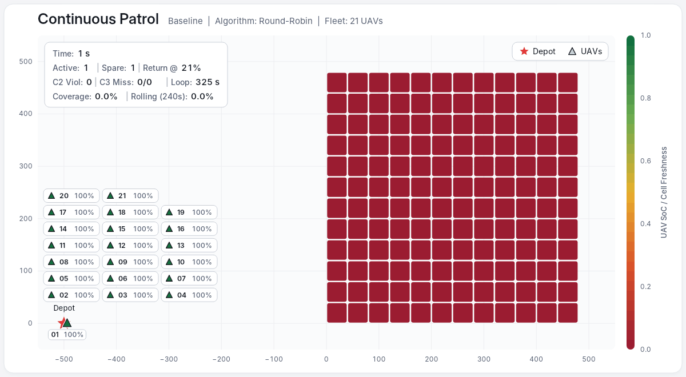

# Persistent UAV Surveillance

Simulator for persistent surveillance by a UAV swarm, built on the **Ground Station
Monitor (GSM)** architecture of the original implementation,
[abhirva/persistent-uav-surveillance](https://github.com/abhirva/persistent-uav-surveillance).

The simulator evaluates persistent observation of a rectangular region by
battery-limited UAVs. Depots outside the region supply replacement UAVs, so finite
endurance at the level of a single UAV becomes persistent coverage at the level
of the swarm when coverage and replacement constraints are met; a reserve UAV
is dispatched when one UAV fails. The simulator runs the
GSM at 1 Hz, monitors C1-C4, and adds return, queue and obstacle checks C5-C7
for extended runs.



*The nominal scenario (N = 21), the whole 4800 s run. Tiles run from red (overdue) to
green (just observed); each UAV carries its battery level, and fresh UAVs leave the
depot as the others run low. The single-failure video adds a violet banner that
follows the response to a lost UAV.
Regenerate with `python scripts/export_frames.py nominal` then
`python scripts/render_animation.py results/frames/nominal.json --mode gif`.*

The baseline follows the original implementation stage by stage; the shared-loop
mode changes route construction and failure response.
[design-notes.md](docs/design-notes.md) lists the quantities it leaves open and how they
were chosen.

## Quick start

```bash
python -m venv .venv && source .venv/bin/activate
pip install -e ".[dev,plot,video]"    # Python >= 3.14; the simulator itself needs no packages

pytest                                 # 171 tests, including full-mission safety checks
python -m uav_surveil                  # nominal run (N = 21, 4800 s), summary on stdout
python scripts/run_scenarios.py      # the five scenarios, results/ + figures
python scripts/export_frames.py all    # per-frame state of every scenario, results/frames/
python scripts/render_animation.py results/frames/nominal.json --mode gif   # the animation above, assets/nominal-surveillance.gif
python scripts/render_animation.py results/frames/nominal.json                     # one video, assets/videos/ (needs ffmpeg)
```

Command-line options for a single run:

```bash
python -m uav_surveil --config configs/baseline.json \
    --set fleet.size=31 --set mission.duration=9600 \
    --failure 10 1800 --out results/my_run
```

`--set section.name=value` overrides any parameter of `configs/baseline.json`,
`--failure ROUTE TIME` fails the UAV flying that route, and `--out` writes
`metrics.csv` (1 Hz time series), `events.csv` (launches, returns, bridging),
`routes.csv` and `summary.json`.

## Architecture

| Stage | Module | What it does |
|---|---|---|
| Stage 1 | `fleet.py` | Integer fleet split, or loop sizing with per-depot rotation pools and spare placement |
| Stage 2 | `routing.py`, `grid.py` | Round-robin routes or a closed sweep of free cells; endurance check |
| Stage 3 | `schedule.py` | Staggered batch departures |
| Stage 4 | `dispatch.py` | Distance-aware return-to-base and replacement rules |
| Stage 5 | `failure.py` | Bridging of orphan cells and contingency take-over |
| Stage 6 | `monitor.py` | Clauses C1-C7, time series, robustness and recovery summaries |
| GSM | `simulation.py`, `patrol.py` | The 1 Hz loop, relay handovers, re-spacing and depot closure |

Supporting modules: `params.py` (the nominal and open parameters), `geometry.py`
(Euclidean geometry), `airspace.py` (obstacle paths and free cells), `depots.py`
(service queues), `coverage.py` (cell ages), `uav.py` (UAV state).

```
uav_surveil/   the package, one module per stage
configs/       baseline.json - the nominal parameters; port.json - the extended map
scripts/       run_scenarios.py - runs the five scenarios and draws the figures
               export_frames.py - per-frame JSON of a scenario; render_animation.py - draws the README GIF and the MP4 videos from it
assets/        nominal-surveillance.gif - the animation shown above; videos/ - full-length MP4 of each scenario
tests/         unit tests per stage and whole-loop invariants
docs/          design notes, extension report, implementation audit, study results and figures
```

## Results

Nominal parameters, fleet split 16 + 4 + 1 at N = 21. Coverage is the
fraction of cells observed within the last Θ = 180 s; the mean includes
the initial deployment transient and the steady-state value is averaged over
t > 1200 s. Regenerate with `python scripts/run_scenarios.py`.

| Scenario | N | Duration (s) | Mean cov. (%) | Peak (%) | Time ≥ 90 % (s) | Steady-state cov. (%) | C2 violations | C3 violations / alarms |
|---|---:|---:|---:|---:|---:|---:|---:|---:|
| Under-provisioned | 11 | 4800 | 57.6 | 80.6 | 0 | 64.1 | 0 | 2 / 12 |
| Nominal | 21 | 4800 | 81.6 | 94.4 | 909 | 88.2 | 0 | 20 / 32 |
| Over-provisioned | 31 | 4800 | 90.8 | 100.0 | 4016 | 99.4 | 0 | 40 / 52 |
| Long horizon | 21 | 9600 | 86.1 | 96.5 | 3862 | 89.6 | 0 | 24 / 80 |
| Single failure (route 10, t_f = 1800 s) | 21 | 4800 | 82.1 | 94.4 | 1195 | 88.8 | 0 | 19 / 32 |

For the failure run, the contingency UAV is launched in the step of the failure,
reaches its route 147 s later, and every orphan cell has been re-observed after
T_rec = 175 s (the implementation uses ε = 120 s for the C4 tolerance).


Three observations from these runs:

* **C2 holds at sampled times** (no airborne UAV is observed below σ_min;
  the smallest margin is 0.019) and
  the swarm responds to a failure with a small transient.
* **C3 does not hold with the nominal reserve.** With n_rotate = N_batch = 4 the
  rotation pool runs empty while the batch-clustered UAVs return together, and
  some replacements are launched up to 153 s after their alarm, beyond τ = 60 s
  (`docs/figures/rotation-pool.png`). With N_batch = 8 (hence 8 rotation UAVs at
  N = 25) only one launch is late. See [design-notes.md](docs/design-notes.md).
* **Coverage depends strongly on the sensing footprint**, which is left
  open: the steady-state coverage at N = 21 is 84.3 % for a 20 m footprint
  radius, 88.2 % for 30 m (the default) and 96.9 % for 40 m.

## Multiple depots and no-fly zones

`configs/port.json` uses a 1200 m square, three depots, two service slots per depot,
and rectangular obstacles leaving 830 free cells. Free cells alone count toward
coverage. Round-robin routes use flyable paths; shared-loop patrols add relay
handovers, phased first sorties, re-spacing after failures, and depot closure.

```bash
python -m uav_surveil --config configs/port.json --out results/port/main
python scripts/run_port_study.py                         # R0-R6 and 20 seeded maps
python scripts/export_frames.py R6                      # closure scenario
python scripts/render_animation.py results/frames/R6.json --mode gif  # assets/r6-surveillance.gif
```

In the implemented study, R3 is round-robin, R4 is the
shared loop, R5 adds four failures and R6 closes the north depot. These run labels
and algorithms differ from the
[extension report](docs/extending-resilient-uav-swarm-surveillance-multiple-depots-and-no-fly-zones.md); see
[the step audit](docs/implementation-status.md).

The recorded 4800 s study gives the following steady-state results (after 1200 s).
The pass verdict requires C2, C5, C6 and C7 at the 1 s monitor samples; it does
not imply continuous freshness or a formal continuous-time safety guarantee.

| Run | Fleet | Steady coverage (%) | C6 violating steps | C2, C5–C7 met |
|---|---:|---:|---:|---|
| R0, straight return metric | 57 | 97.9 | 0 | yes |
| R1, best single depot (east) | 51 | 95.1 | 14 | no |
| R2, no obstacles | 51 | 98.9 | 0 | yes |
| R3, round-robin | 120 | 78.5 | 48 | no |
| R4, shared loop | 57 | 99.2 | 0 | yes |
| R5, four failures | 57 | 97.7 | 0 | yes |
| R6, north depot closed | 57 | 97.7 | 4 | no |

The constructed loop is 40.3 km; the implemented sizing rule assigns 39 flying
drones, 15 rotation drones and 3 spares.
The port configuration adds three rotation drones per serving depot above the
Little's-law floor. R0 does not reproduce the predicted battery failure on this
trajectory; a controlled pocket-return regression demonstrates the unsafe metric.
The ideal revisit formula does not cover deployment, handover gaps and re-spacing
transients. Full metrics, prediction comparisons and random-map results are written
to `results/port/summary.md` by the study script. A snapshot of the verified study
is in [port-study.md](docs/port-study.md). Across 20 random maps, shared-loop
coverage averaged 98.6% versus 78.8% for round-robin; only 6 shared-loop maps and
3 round-robin maps met all four safety and queue checks. Five shared-loop setups
and one round-robin setup were infeasible. Coverage means exclude infeasible
setups (15 shared-loop maps and 19 round-robin maps contribute), so this is not
a paired estimate of improvement. These deterministic simulations do not
establish statistical significance or performance on unseen environments.

## Scope

Uniform grids, homogeneous UAVs, static known rectangular obstacles, instant turns,
exact positions, deterministic energy and travel time, and a centralised GSM.
The baseline uses one depot and round-robin routes. The extended mode supports
multiple depots; consecutive failures and depot closure are supported in shared-loop
mode. No wind, turning-radius limits, moving obstacles or dedicated inventory
rebalancing flights are modelled. Little's-law sizing is an average bound, and the
loop's ideal revisit interval is not a guarantee through handover or failure transients.

## Licence

MIT, see [LICENSE](LICENSE).
