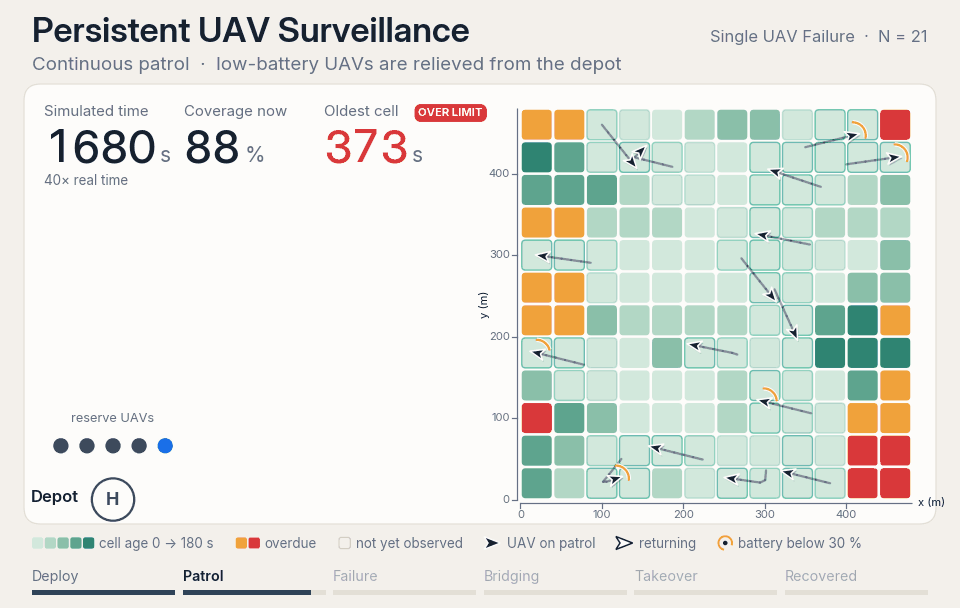
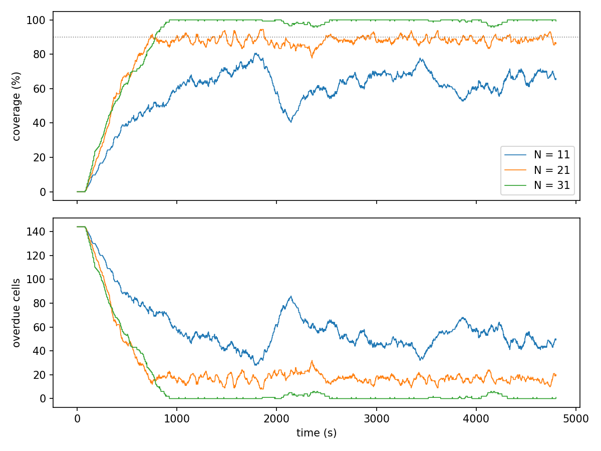

# Persistent UAV Surveillance

Simulator for persistent surveillance by a UAV swarm, built on the **Ground Station
Monitor (GSM)** architecture of the original implementation,
[abhirva/persistent-uav-surveillance](https://github.com/abhirva/persistent-uav-surveillance).

A swarm of battery-limited UAVs keeps a rectangular region under continuous
observation. A depot outside the region supplies replacement UAVs, so finite
endurance at the level of a single UAV becomes persistent coverage at the level
of the swarm; a reserve UAV takes over when one UAV fails. The simulator runs the
GSM at 1 Hz and monitors the four STL clauses C1-C4.



*The nominal scenario (N = 21), the whole 4800 s run. Tiles run from red (overdue) to
green (just observed); each UAV carries its battery level, and fresh UAVs leave the
depot as the others run low. The single-failure video adds a violet banner that
follows the response to a lost UAV.
Regenerate with `python scripts/export_frames.py nominal` then
`python scripts/render_animation.py results/frames/nominal.json --mode gif`.*

The code follows the original implementation stage by stage.
`docs/design_notes.md` lists the quantities it leaves open and how they
were chosen.

## Quick start

```bash
python -m venv .venv && source .venv/bin/activate
pip install -e ".[dev,plot,video]"    # Python >= 3.14; the simulator itself needs no packages

pytest                                 # 56 tests, ~2 s
python -m uav_surveil                  # nominal run (N = 21, 4800 s), summary on stdout
python scripts/run_scenarios.py      # the five scenarios, results/ + figures
python scripts/export_frames.py all    # per-frame state of every scenario, results/frames/
python scripts/render_animation.py results/frames/nominal.json --mode gif   # the animation above, assets/demo.gif
python scripts/render_animation.py results/frames/nominal.json                     # one video, assets/videos/ (needs ffmpeg)
```

Command-line options for a single run:

```bash
python -m uav_surveil --config configs/baseline.json \
    --set fleet.size=31 --set mission.duration=9600 \
    --failure 10 1800 --out results/my_run
```

`--set section.name=value` overrides any parameter of `configs/baseline.json`,
`--failure ROUTE TIME` fails the UAV flying that route, and `--out` writes
`metrics.csv` (1 Hz time series), `events.csv` (launches, returns, bridging),
`routes.csv` and `summary.json`.

## Architecture

| Stage | Module | What it does |
|---|---|---|
| Stage 1 | `fleet.py` | Fleet split into flying / rotation / spare UAVs, integer program for the split |
| Stage 2 | `routing.py`, `grid.py` | Boustrophedon cell ordering dealt out round-robin; endurance check |
| Stage 3 | `schedule.py` | Staggered batch departures |
| Stage 4 | `dispatch.py` | Distance-aware return-to-base and replacement rules |
| Stage 5 | `failure.py` | Bridging of orphan cells and contingency take-over |
| Stage 6 | `monitor.py` | Clauses C1-C4, time series and summary |
| GSM | `simulation.py` | The 1 Hz loop that sequences Stages 3-6 |

Supporting modules: `params.py` (the nominal and open parameters), `geometry.py`
(the single place where distances and motion are defined), `coverage.py` (cell
ages), `uav.py` (UAV state).

```
uav_surveil/   the package, one module per stage
configs/       baseline.json - the nominal parameters
scripts/       run_scenarios.py - runs the five scenarios and draws the figures
               export_frames.py - per-frame JSON of a scenario; render_animation.py - draws the README GIF and the MP4 videos from it
assets/        demo.gif - the animation shown above; videos/ - full-length MP4 of each scenario
tests/         unit tests per stage and whole-loop invariants
docs/          implementation notes and figures
```

## Results

Nominal parameters, fleet split 16 + 4 + 1 at N = 21. Coverage is the
fraction of cells observed within the last Θ = 180 s; the mean includes
the initial deployment transient and the steady-state value is averaged over
t > 1200 s. Regenerate with `python scripts/run_scenarios.py`.

| Scenario | N | Duration (s) | Mean cov. (%) | Peak (%) | Time ≥ 90 % (s) | Steady-state cov. (%) | C2 violations | C3 violations / alarms |
|---|---:|---:|---:|---:|---:|---:|---:|---:|
| Under-provisioned | 11 | 4800 | 57.6 | 80.6 | 0 | 64.1 | 0 | 2 / 12 |
| Nominal | 21 | 4800 | 81.6 | 94.4 | 909 | 88.2 | 0 | 20 / 32 |
| Over-provisioned | 31 | 4800 | 90.8 | 100.0 | 4016 | 99.4 | 0 | 40 / 52 |
| Long horizon | 21 | 9600 | 86.1 | 96.5 | 3862 | 89.6 | 0 | 24 / 80 |
| Single failure (route 10, t_f = 1800 s) | 21 | 4800 | 82.1 | 94.4 | 1195 | 88.8 | 0 | 19 / 32 |

For the failure run, the contingency UAV is launched in the step of the failure,
reaches its route 147 s later, and every orphan cell has been re-observed after
T_rec = 175 s (the C4 verdict depends on the tolerance ε, which is left open).



Three observations from these runs:

* **C2 holds** (no UAV ever falls below σ_min; the smallest margin is 0.019) and
  the swarm responds to a failure with a small transient.
* **C3 does not hold with the nominal reserve.** With n_rotate = N_batch = 4 the
  rotation pool runs empty while the batch-clustered UAVs return together, and
  some replacements are launched up to 153 s after their alarm, beyond τ = 60 s
  (`docs/figures/rotation_pool.png`). With N_batch = 8 (hence 8 rotation UAVs at
  N = 25) only one launch is late. See `docs/design_notes.md`.
* **Coverage depends strongly on the sensing footprint**, which is left
  open: the steady-state coverage at N = 21 is 84.3 % for a 20 m footprint
  radius, 88.2 % for 30 m (the default) and 96.9 % for 40 m.

## Scope

Single depot, uniform grid, homogeneous UAVs, straight-line flight, a linear
battery model, one failure at a time, a centralised GSM with perfect state, and
no wind or obstacles - the assumptions of the original implementation. Distances and motion are
isolated in `geometry.py` so that other geometries can be substituted.

## Licence

MIT, see `LICENSE`.
