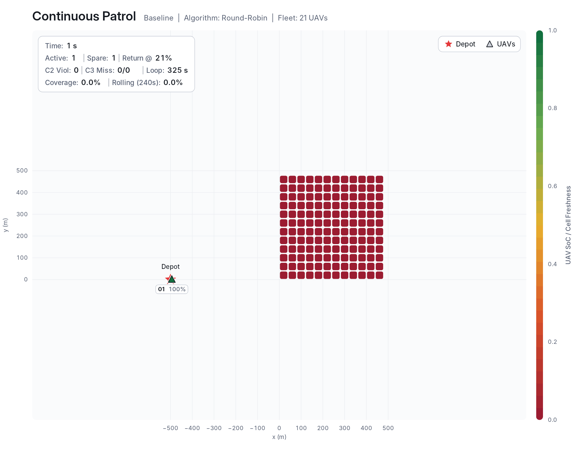
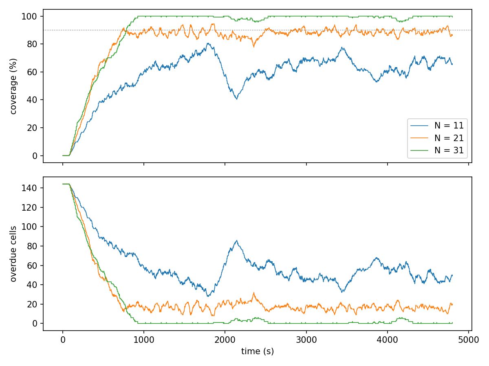
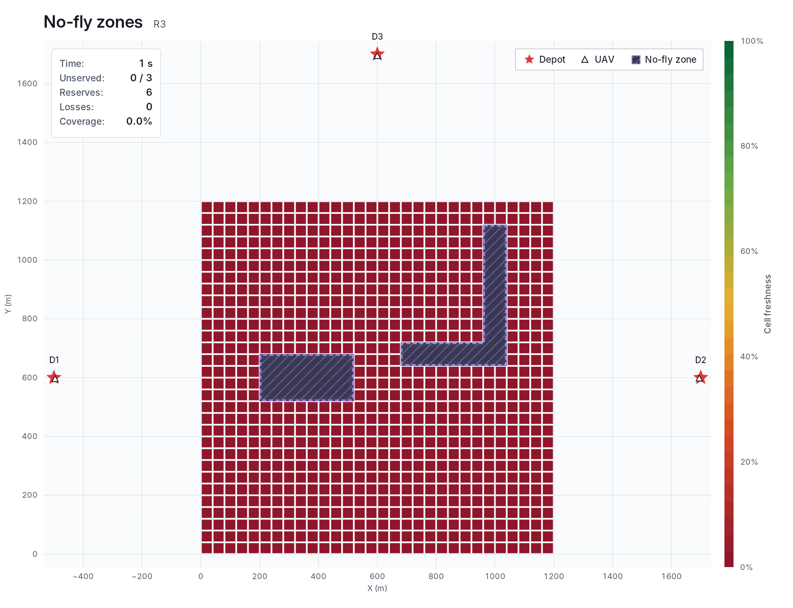

# Persistent UAV Surveillance

Simulator for persistent surveillance by a UAV swarm, built on the **Ground Station
Monitor (GSM)** architecture of the original implementation,
[abhirva/persistent-uav-surveillance](https://github.com/abhirva/persistent-uav-surveillance).

The simulator evaluates persistent observation of a rectangular region by
battery-limited UAVs. Depots outside the region supply replacement UAVs, so finite
endurance at the level of a single UAV becomes persistent coverage at the level
of the swarm when coverage and replacement constraints are met; a reserve UAV
is dispatched when one UAV fails. The simulator runs the
GSM at 1 Hz, monitors C1-C4, and adds return, queue and obstacle checks C5-C7
for extended runs.



*The nominal scenario (N = 21), the whole 4800 s run. Tiles run from red (overdue) to
green (just observed); each UAV carries its battery level, and fresh UAVs leave the
depot as the others run low. The single-failure video adds a violet banner that
follows the response to a lost UAV.
To render a new preview with the current layout, run `python scripts/export_frames.py nominal` then
`python scripts/render_animation.py results/frames/nominal.json --mode gif`.*

The primary planner uses Choset boustrophedon decomposition followed by
round-robin assignment within depot sectors. The shared-loop planner has been removed.
[design-notes.md](docs/design-notes.md) lists the quantities it leaves open and how they
were chosen.

## Quick start

```bash
python -m venv .venv && source .venv/bin/activate
pip install -e ".[dev,plot,video]"    # Python >= 3.14; the simulator itself needs no packages

pytest                                 # unit tests and full-mission checks
python -m uav_surveil                  # nominal run (N = 21, 4800 s), summary on stdout
python scripts/run_scenarios.py      # the five scenarios, results/ + figures
python scripts/export_frames.py all    # per-frame state of every scenario, results/frames/
python scripts/render_animation.py results/frames/nominal.json --mode gif   # a newly rendered preview, assets/multi_depot/nominal-surveillance.gif
python scripts/render_animation.py results/frames/nominal.json                     # one video, assets/multi_depot/videos/ (needs ffmpeg)
```

Command-line options for a single run:

```bash
python -m uav_surveil --config configs/baseline.json \
    --set fleet.size=31 --set mission.duration=9600 \
    --failure 10 1800 --out results/my_run
```

`--set section.name=value` overrides any parameter of `configs/baseline.json`,
`--failure ROUTE TIME` fails the UAV flying that route, and `--out` writes
`metrics.csv` (1 Hz time series), `events.csv` (launches, returns, bridging),
`routes.csv` and `summary.json`.

## Architecture

| Stage | Module | What it does |
|---|---|---|
| Stage 1 | `fleet.py` | Integer fleet split and proportional per-depot reserve inventories |
| Stage 2 | `routing.py`, `grid.py` | Choset connectivity-event decomposition, sector-local round-robin and endurance checks |
| Stage 3 | `schedule.py` | Staggered batch departures |
| Stage 4 | `dispatch.py` | Distance-aware return-to-base and replacement rules |
| Stage 5 | `failure.py` | Bridging of orphan cells and contingency take-over |
| Stage 6 | `monitor.py` | Clauses C1-C7, time series, robustness and recovery summaries |
| GSM | `simulation.py` | The 1 Hz controller, repeated failures and depot closure |

Supporting modules: `params.py` (the nominal and open parameters), `geometry.py`
(Euclidean geometry), `airspace.py` (obstacle paths and free cells), `depots.py`
(service queues), `coverage.py` (cell ages), `uav.py` (UAV state).

```
uav_surveil/   the package, one module per stage
configs/       baseline.json - the nominal parameters; port.json - the extended map
scripts/       run_scenarios.py - runs the five scenarios and draws the figures
               export_frames.py - per-frame JSON of a scenario; render_animation.py - draws the README GIF and the MP4 videos from it
               render_port_animations.py - exports and renders the five extended demonstrations
assets/        single_depot/ - preserved baseline media; multi_depot/ - newer renders; README.md - media catalogue
tests/         unit tests per stage and whole-loop invariants
docs/          design notes, extension report, implementation audit, study results and figures
```

## Results

Nominal parameters, fleet split 16 + 4 + 1 at N = 21. Coverage is the
fraction of cells observed within the last Θ = 180 s; the mean includes
the initial deployment transient and the steady-state value is averaged over
t > 1200 s. Regenerate with `python scripts/run_scenarios.py`.

| Scenario | N | Duration (s) | Mean cov. (%) | Peak (%) | Time ≥ 90 % (s) | Steady-state cov. (%) | C2 violations | C3 violations / alarms |
|---|---:|---:|---:|---:|---:|---:|---:|---:|
| Under-provisioned | 11 | 4800 | 57.6 | 80.6 | 0 | 64.1 | 0 | 2 / 12 |
| Nominal | 21 | 4800 | 81.6 | 94.4 | 909 | 88.2 | 0 | 20 / 32 |
| Over-provisioned | 31 | 4800 | 90.8 | 100.0 | 4016 | 99.4 | 0 | 40 / 52 |
| Long horizon | 21 | 9600 | 86.1 | 96.5 | 3862 | 89.6 | 0 | 24 / 80 |
| Single failure (route 10, t_f = 1800 s) | 21 | 4800 | 82.1 | 94.4 | 1195 | 88.8 | 0 | 19 / 32 |

For the failure run, the contingency UAV is launched in the step of the failure,
reaches its route 147 s later, and every orphan cell has been re-observed after
T_rec = 175 s (the implementation uses ε = 120 s for the C4 tolerance).



Three observations from these runs:

* **C2 holds at sampled times** (no airborne UAV is observed below σ_min;
  the smallest margin is 0.019) and
  the swarm responds to a failure with a small transient.
* **C3 does not hold with the nominal reserve.** With n_rotate = N_batch = 4 the
  rotation pool runs empty while the batch-clustered UAVs return together, and
  some replacements are launched up to 153 s after their alarm, beyond τ = 60 s
  (`docs/figures/rotation-pool.png`). With N_batch = 8 (hence 8 rotation UAVs at
  N = 25) only one launch is late. See [design-notes.md](docs/design-notes.md).
* **Coverage depends strongly on the sensing footprint**, which is left
  open: the steady-state coverage at N = 21 is 84.3 % for a 20 m footprint
  radius, 88.2 % for 30 m (the default) and 96.9 % for 40 m.

## Multiple depots and no-fly zones

`configs/port.json` uses a 1200 m square, three depots, two service slots per depot,
and rectangular obstacles leaving 830 free cells. Free cells alone count toward
coverage. Every depot is 500 m from its nearest outer boundary point. The fleet
has 120 UAVs (87 flying, 27 rotation and 6 spare). Choset decomposition supplies
sweep waypoints, assigned round-robin within nearest-flyable-depot sectors.
Travel uses NFZ-safe paths. Repeated failures trigger bridging and spare takeover;
depot closure rehomes affected routes and redirects incoming UAVs.

```bash
python -m uav_surveil --config configs/port.json --out results/port/main
python scripts/run_port_study.py --out results/port-choset-round-robin # R0-R6 and 20 maps
python scripts/export_frames.py R6                      # closure scenario
python scripts/render_animation.py results/frames/R6.json --mode gif  # assets/multi_depot/r6-surveillance.gif
python scripts/render_port_animations.py all             # nine fixed-scenario MP4s and GIFs, with descriptive filenames
```

The [animation catalogue](assets/README.md) links the multiple-depot and no-fly-zone
demonstrations, including repeated failures and depot closure. They use the same
Skia layout, palette, battery labels and coverage display as the baseline. Each
MP4 covers all 4800 simulation seconds at 60× speed (about 80 seconds); each GIF condenses the full
run into a 12-second looping preview. Gray rectangles mark no-fly zones; red stars
mark depots. Failed UAVs become violet crosses, and event banners identify failures
and closure. Coverage counts only free cells.



All study runs now use Choset decomposition plus round-robin. R3 is the main
no-fly-zone run, R4 adds one failure, R5 adds four failures and R6 closes the
north depot. R0 uses a straight-distance return estimate, R1 tests each depot
alone, and R2 removes obstacles. The 20 random maps test the main method on
additional layouts. See [the recorded results](docs/port-study.md) for the
measured coverage, queues, battery margins and recovery times.

The historical shared-loop results do not apply to this planner or to the
500 m depot setback. A zero battery/NFZ violation count does not establish
freshness or queue-capacity compliance. Report all monitor outcomes rather
than assuming that the new routes satisfy every constraint.

## Scope

Uniform grids, homogeneous UAVs, static known rectangular obstacles, instant turns,
exact positions, deterministic energy and travel time, and a centralised GSM.
Choset decomposition is implemented on the free-cell raster. The same primary
planner supports one or multiple depots, repeated failures and depot closure.
No wind, turning-radius limits, moving obstacles, dedicated inventory rebalancing
or inter-drone collision avoidance is modelled. Capacity-weighted sector balancing
and global replanning after spare exhaustion remain future work.

## Licence

MIT, see [LICENSE](LICENSE).
