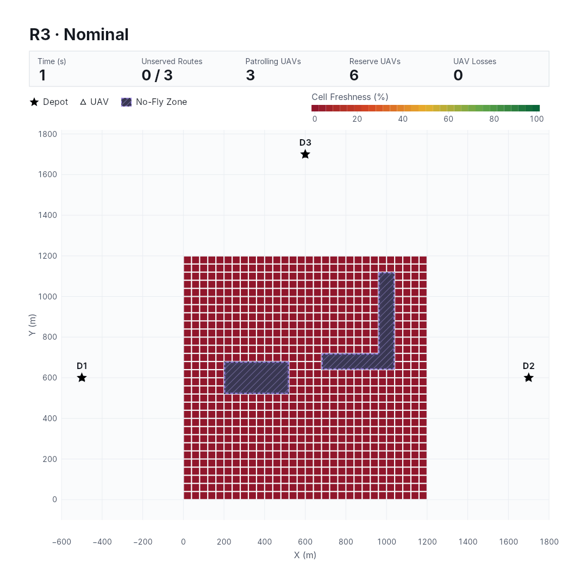

# Persistent UAV Surveillance

The simulator models persistent surveillance by battery-limited UAVs that return to depots for service. Part 1 covers battery rotation and single-aircraft failure at one depot. Part 2 adds multiple depots, no-fly zones (NFZs) and finite service capacity, then tests repeated failures and depot closure. The simulator builds on Abhirva Navalakhe's ground-station scheduling architecture. [Original simulator](https://github.com/abhirva/persistent-uav-surveillance)

## Measurement protocol

The Ground Station Monitor samples the simulation every second. An airborne UAV observes a cell when the cell's centroid is within sensing range, including during transit. A cell is fresh if it was last observed 180 s ago or less. Coverage is the percentage of required cells that are fresh at each sample. Mean coverage uses the full run, including deployment. Steady coverage averages samples after 1200 s, even when deployment is still underway. Time at or above 90% coverage is the sum of the qualifying sample intervals. [Coverage and monitor implementation](uav_surveil/monitor.py), [observation model](uav_surveil/simulation.py)

| Clause | Reported quantity |
|---|---|
| C1 | Time with every required cell fresh |
| C2 | Samples with at least one airborne UAV below the 10% state-of-charge floor |
| C3 | Rotation and contingency launch alarms whose latency exceeds 60 s. An unanswered alarm contributes its elapsed wait through mission end. |
| C4 | Local recovery time to re-observe every cell on a failed route, with a 300 s limit. Part 2 also reports region-wide recovery to full freshness within each failure window, which ends at the next failure or mission end. |
| C5 | Samples with insufficient charge for an airborne UAV to reach the nearest open depot by a flyable route and retain the battery floor |
| C6 | Samples when a depot's waiting count exceeds its service-slot count. UAVs already in service are excluded from the waiting count. |
| C7 | Samples when an airborne UAV violates the configured NFZ clearance |

The port runner reports a pass when C2 and C5–C7 have zero violating samples across the mission. [Monitor implementation](uav_surveil/monitor.py)

## Part 1 — Single-depot baseline

The baseline uses a 500 m × 500 m region with 144 whole 40 m cells and a single depot at (−500, 0) m. Round-robin patrol routes, staggered departures and battery-aware replacement maintain coverage across sorties. The nominal 21-aircraft inventory has 16 patrol, four rotation and one contingency UAV. The default aircraft flies at 6 m/s with a 30 m sensing radius, 2100 s of full-charge endurance and a 60 s depot turnaround. The 10% reserve gives 1890 s of usable airborne endurance. [Baseline configuration](configs/baseline.json), [design notes](docs/design-notes.md)

| Run | UAVs | Duration (s) | Mean coverage (%) | Steady coverage (%) | Peak coverage (%) | Time ≥90% (s) | C2 samples | C3 late / alarms |
|---|---:|---:|---:|---:|---:|---:|---:|---:|
| Under-provisioned | 11 | 4800 | 57.6 | 64.1 | 80.6 | 0 | 0 | 2 / 12 |
| Nominal | 21 | 4800 | 81.6 | 88.2 | 94.4 | 909 | 0 | 20 / 32 |
| Over-provisioned | 31 | 4800 | 90.8 | 99.4 | 100.0 | 4016 | 0 | 40 / 52 |
| Long horizon | 21 | 9600 | 86.1 | 89.6 | 96.5 | 3862 | 0 | 24 / 80 |
| Single failure | 21 | 4800 | 82.1 | 88.8 | 94.4 | 1195 | 0 | 19 / 32 |

When the UAV on route 10 fails at 1800 s, a spare launches immediately and takes over 147 s later. All cells on the route are observed again within 175 s, meeting the 300 s local recovery limit. In the nominal run, 20 of 32 launch alarms are answered late even though the airborne fleet stays above the battery floor at every sample. [Baseline runner](scripts/run_scenarios.py)

<details>
<summary>Baseline sensitivity and waypoint experiments</summary>

Each row changes the stated settings from the nominal baseline. The 30 m radius and 0.06 prelaunch margin reference the nominal result above. A 1 m sensing radius tests near-waypoint observation. Flight segments can also pass within that radius of other cell centroids. Changing batch size affects deployment and fleet allocation. [Design notes](docs/design-notes.md)

| Setting | UAVs | Patrol + rotation + contingency | Steady coverage (%) | C3 late / alarms |
|---|---:|---|---:|---:|
| Sensing radius 20 m | 21 | 16 + 4 + 1 | 84.3 | 20 / 32 |
| Sensing radius 40 m | 21 | 16 + 4 + 1 | 96.9 | 20 / 32 |
| Sensing radius 1 m | 11 | 6 + 4 + 1 | 30.3 | 2 / 12 |
| Sensing radius 1 m | 21 | 16 + 4 + 1 | 45.4 | 20 / 32 |
| Sensing radius 1 m | 31 | 26 + 4 + 1 | 94.6 | 40 / 52 |
| Prelaunch margin 0.03 | 21 | 16 + 4 + 1 | 87.8 | 9 / 32 |
| Prelaunch margin 0.04 | 21 | 16 + 4 + 1 | 87.6 | 18 / 32 |
| Prelaunch margin 0.10 | 21 | 16 + 4 + 1 | 87.6 | 20 / 35 |
| Batch size 2 | 21 | 18 + 2 + 1 | 91.4 | 30 / 36 |
| Batch size 6 | 21 | 14 + 6 + 1 | 86.3 | 8 / 28 |
| Batch size 8 | 25 | 16 + 8 + 1 | 90.5 | 1 / 32 |

Use repeatable `--set section.name=value` arguments with `python -m uav_surveil --config configs/baseline.json` to set `uav.sensing_radius` in metres, `dispatch.prelaunch_margin` as a charge fraction, `fleet.batch_size` or `fleet.size`.

</details>

## Part 2 — Multiple depots and no-fly zones

Part 2 retains the baseline aircraft and freshness parameters and expands the region to 1200 m × 1200 m. The nominal map defines three rectangular exclusions, two of which form an L-shaped obstacle. The configured clearance buffer is 0 m. The exclusions remove 70 of the 900 grid cells from the coverage denominator, leaving 830 required cells. The west, east and north depots are at (−500, 600), (1700, 600) and (600, 1700) m. Each is 500 m from the region boundary and has two parallel service slots. The nominal inventory is 120 UAVs, split into 87 patrol, 27 rotation and six contingency aircraft. [Port configuration](configs/port.json)

The planner assigns free cells to the nearest depot by flyable distance. Within each sector it sweeps the regions produced by raster boustrophedon decomposition and assigns waypoints round-robin to cyclic patrols. The airspace model uses straight segments where clear and raster-graph detours where needed. The controller dispatches reserves for battery rotation, inserts temporary visits to orphan cells after aircraft loss, and reassigns routes and diverts inbound aircraft after depot closure. [Choset's decomposition](https://doi.org/10.1023/A%3A1008958800904), [routing](uav_surveil/routing.py), [controller](uav_surveil/simulation.py)



*Nominal Part 2 run (R3). Cell colour represents freshness, triangles show airborne UAVs, stars mark depots and hatched areas mark NFZs.*

### Fixed scenarios and nominal variants

R0–R6 start with 120 UAVs and run for 4800 s. The three additional R3 variants change only fleet inventory or duration. Peak cell age is the largest sampled age strictly after both the 1200 s cutoff and the first full observation of the required cells. [Port study runner](scripts/run_port_study.py), [R3 variant definitions](scripts/export_frames.py)

| Run | Change from R3 | UAVs | Duration (s) | Mean coverage (%) | Steady coverage (%) | Peak coverage (%) | Time ≥90% (s) | Peak cell age (s) |
|---|---|---:|---:|---:|---:|---:|---:|---:|
| R0 | Straight-line distance for dispatch thresholds and return-depot selection. Flight paths still avoid NFZs. | 120 | 4800 | 81.97 | 89.99 | 94.94 | 2087 | 1072 |
| R1_west | West depot only, with six service slots. | 120 | 4800 | 66.20 | 79.47 | 88.92 | 0 | 1614 |
| R1_east | East depot only, with six service slots. | 120 | 4800 | 65.39 | 78.71 | 84.82 | 0 | 1606 |
| R1_north | North depot only, with six service slots. | 120 | 4800 | 65.65 | 77.94 | 86.39 | 0 | 1653 |
| R2 | Remove NFZs and monitor all 900 cells. | 120 | 4800 | 81.20 | 90.19 | 94.11 | 2264 | 1116 |
| R3 | Nominal map, three depots and flyable-distance dispatch. | 120 | 4800 | 81.97 | 89.99 | 94.82 | 2090 | 1015 |
| R4 | One UAV failure at 1800 s. | 120 | 4800 | 81.98 | 90.01 | 94.82 | 2107 | 1015 |
| R5 | Four UAV failures at 1800, 2100, 2400 and 2700 s. | 120 | 4800 | 82.00 | 90.04 | 94.70 | 2086 | 1015 |
| R6 | North depot closes at 1800 s. | 120 | 4800 | 81.41 | 89.24 | 94.10 | 2096 | 1289 |
| R3_under_provisioned | Reduce the fleet with the same service capacity and batch-size limit. | 90 | 4800 | 69.84 | 77.87 | 84.22 | 0 | 1645 |
| R3_over_provisioned | Increase the fleet with the same service capacity and batch-size limit. | 150 | 4800 | 82.70 | 91.77 | 94.94 | 3447 | 987 |
| R3_long_horizon | Double the mission duration. | 120 | 9600 | 86.28 | 90.33 | 94.82 | 5414 | 1015 |

| Run | C2 samples | C3 late / alarms | C5 samples | C6 samples | C7 samples |
|---|---:|---:|---:|---:|---:|
| R0 | 0 | 54 / 174 | 0 | 520 | 0 |
| R1_west | 0 | 0 / 173 | 0 | 0 | 0 |
| R1_east | 0 | 0 / 172 | 0 | 0 | 0 |
| R1_north | 0 | 0 / 174 | 0 | 0 | 0 |
| R2 | 0 | 47 / 174 | 0 | 600 | 0 |
| R3 | 0 | 47 / 174 | 0 | 487 | 0 |
| R4 | 0 | 47 / 175 | 0 | 487 | 0 |
| R5 | 0 | 47 / 178 | 0 | 487 | 0 |
| R6 | 124 | 106 / 174 | 219 | 2069 | 0 |
| R3_under_provisioned | 0 | 10 / 116 | 0 | 206 | 0 |
| R3_over_provisioned | 0 | 84 / 231 | 0 | 873 | 0 |
| R3_long_horizon | 0 | 48 / 435 | 0 | 551 | 0 |

All fixed scenarios and R3 variants record zero samples with every required cell fresh (C1).

- **Nominal operation and controls.** R3 averages 89.99% steady coverage and reaches a peak cell age of 1015 s against the 180 s freshness threshold. R0 matches R3's steady coverage to two decimal places and records more late launches and queue-limit samples. R1 west leads the single-depot runs at 79.47% steady coverage. The R1 comparisons also change deployment schedules and pool reserves at one depot. R2 changes both route geometry and the coverage denominator.
- **Fleet size and horizon.** With service capacity fixed, the 90-, 120- and 150-UAV runs allocate 58, 87 and 115 patrol UAVs, respectively. Steady coverage increases across those runs, and C6 violations rise from 206 to 487 to 873 samples. The 9600 s run extends the observation window and still exceeds the revisit and queue limits.
- **Depot closure.** R6 reassigns 25 north-depot routes at 1800 s. It records 124 samples below the battery floor and 219 return-feasibility violations, despite steady coverage of 89.24%. Its minimum battery margin is −0.0587 as a fraction of full charge relative to the reserve floor.

### Recovery after aircraft loss

R4 and R5 inject failures on routes served by the east depot. A spare launches immediately after each failure, and every affected route's cells are observed again within the 300 s limit. The whole region never becomes fresh during either run. All 47 late alarms in each run come from routine battery rotation. The table gives launch, takeover and recovery times relative to each failure. [Failure implementation](uav_surveil/failure.py)

| Run | Failure time (s) | Route | Failed UAV | Spare UAV | Launch depot | Launch delay (s) | Route takeover (s) | Local recovery (s) | Region-wide recovery |
|---|---:|---:|---:|---:|---|---:|---:|---:|---|
| R4 | 1800 | 35 | 100 | 117 | East | 0 | 193 | 128 | Unmet |
| R5 | 1800 | 35 | 100 | 117 | East | 0 | 193 | 128 | Unmet |
| R5 | 2100 | 45 | 42 | 118 | East | 0 | 140 | 155 | Unmet |
| R5 | 2400 | 61 | 46 | 119 | North | 0 | 274 | 256 | Unmet |
| R5 | 2700 | 47 | 45 | 120 | North | 0 | 313 | 289 | Unmet |

### Seeded obstacle layouts

Each seed generates a layout of rectangular obstacles aligned to the grid. Obstacles cover about 8% of the grid and leave the free cells connected. Each layout gets one deterministic run with R3's fleet, controller, depot positions and duration. All 20 runs complete. Mean steady coverage is 88.62% (range 86.05–91.33%), and peak cell age ranges from 800 to 1727 s. [Map generator and study runner](scripts/run_port_study.py)

| Seed | Rectangles | Required cells | Steady coverage (%) | Peak cell age (s) | C2 and C5–C7 met |
|---:|---:|---:|---:|---:|---|
| 0 | 3 | 820 | 90.35 | 1049 | No |
| 1 | 4 | 825 | 89.60 | 1011 | No |
| 2 | 5 | 824 | 86.36 | 1109 | No |
| 3 | 2 | 828 | 87.14 | 1051 | No |
| 4 | 5 | 823 | 87.64 | 1088 | No |
| 5 | 4 | 820 | 91.33 | 1073 | No |
| 6 | 4 | 824 | 89.59 | 1079 | No |
| 7 | 5 | 820 | 88.44 | 1005 | No |
| 8 | 5 | 818 | 88.99 | 1657 | No |
| 9 | 3 | 824 | 88.89 | 1168 | No |
| 10 | 4 | 825 | 88.59 | 1006 | No |
| 11 | 3 | 825 | 89.31 | 1727 | No |
| 12 | 3 | 821 | 87.44 | 1665 | No |
| 13 | 4 | 820 | 88.32 | 1173 | No |
| 14 | 4 | 818 | 91.23 | 800 | No |
| 15 | 4 | 827 | 87.66 | 1677 | No |
| 16 | 4 | 819 | 90.65 | 1041 | No |
| 17 | 3 | 820 | 87.55 | 1103 | No |
| 18 | 5 | 818 | 87.26 | 1018 | No |
| 19 | 4 | 820 | 86.05 | 1034 | No |

The model assumes homogeneous aircraft, exact positions, instantaneous turns, constant travel speed, deterministic energy use and service times, and static known obstacles. Inter-aircraft collision avoidance is outside the model. The reported results quantify the tested trajectories at one-second resolution. [Design notes](docs/design-notes.md)

## Quick start

From the repository root, use Python 3.14 or later. The simulator uses the standard library. The `dev` extra installs pytest.

```bash
python -m venv .venv
source .venv/bin/activate
python -m pip install -e ".[dev]"
python -m pytest
python -m uav_surveil --config configs/port.json --out results/part2/nominal
```

## Reproduce the experiments

The reruns used Python 3.14.4.

```bash
python scripts/run_scenarios.py --no-plots --out results/part1
python scripts/run_port_study.py --no-plots --out results/part2/study
python -m uav_surveil --config configs/port.json --set fleet.size=90 --out results/part2/R3_under_provisioned
python -m uav_surveil --config configs/port.json --set fleet.size=150 --out results/part2/R3_over_provisioned
python -m uav_surveil --config configs/port.json --set mission.duration=9600 --out results/part2/R3_long_horizon
```

Fixed-run output includes `parameters.json`, `summary.json`, sampled `metrics.csv`, time-stamped `events.csv` and `routes.csv`. The Part 2 study runner also writes `random_maps.csv`, `summary.md` and a source-fingerprint manifest, `reproducibility.json`. Outputs under `results/` are generated locally and ignored by Git.

The earlier shared-loop experiments used different configurations and run definitions. Retrieve the study record with `git show a4d219f:docs/port-study.md` and the implementation audit with `git show a4d219f:docs/implementation-status.md`.

## Citation and licence

Software citation metadata is in [CITATION.cff](CITATION.cff). The repository uses the [MIT licence](LICENSE).
